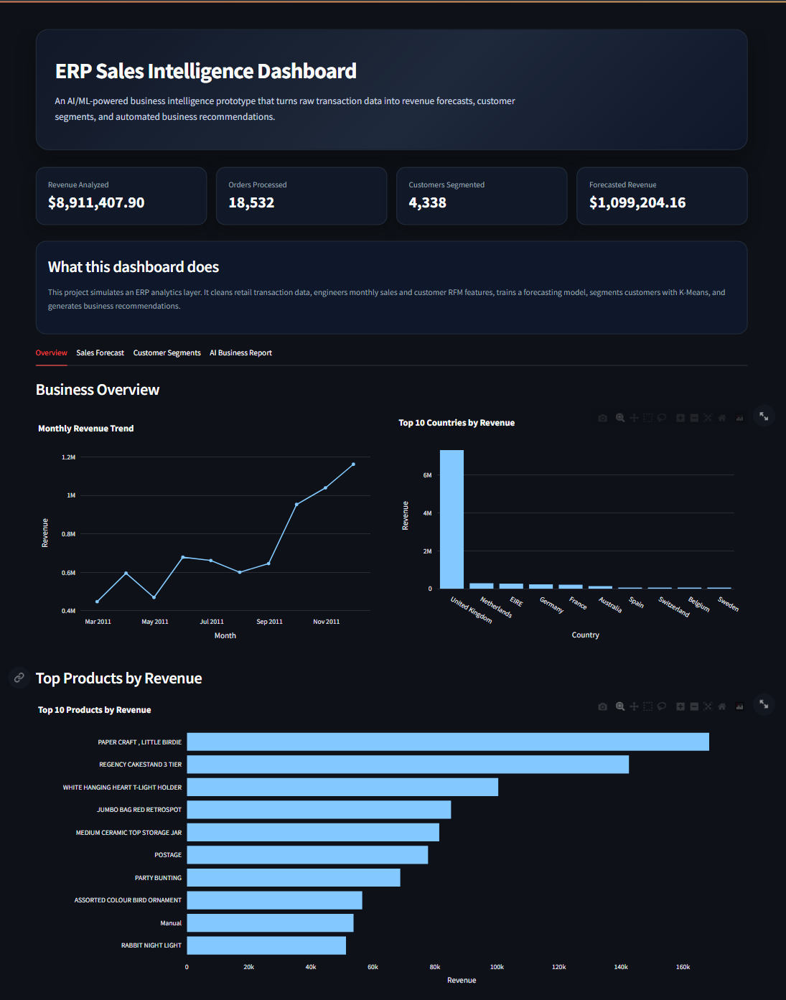

# 📊 ERP Sales Intelligence Dashboard

An AI/ML-powered business intelligence dashboard that transforms raw retail transaction data into **sales forecasts**, **customer segments**, and **automated business recommendations**.

## 🖼️ Project Preview

## 🚀 Overview

This project simulates an ERP analytics layer similar to what a company could build on top of systems such as **Odoo**, **Shopify**, or an internal sales database.

The goal was to practice an end-to-end machine learning workflow:

**raw transaction data → data cleaning → feature engineering → model training → customer segmentation → dashboard insights**

The dashboard turns sales data into:

- Monthly revenue forecasts
- Customer behavior segments
- Product and country revenue insights
- AI-style business recommendations
- An interactive Streamlit dashboard

## 📦 Dataset

This project uses the **Online Retail** dataset, which contains transaction records from a UK-based online retail business.

| Column | Meaning |
|---|---|
| InvoiceNo | Invoice or order number |
| StockCode | Product code |
| Description | Product name |
| Quantity | Number of items purchased |
| InvoiceDate | Transaction date |
| UnitPrice | Price per unit |
| CustomerID | Customer identifier |
| Country | Customer country |

The raw dataset is not included in this repository.

To run the project, download the dataset and place the Excel file here:

`data/raw/Online Retail.xlsx`

## 🗂️ Project Structure

`erp-sales-intelligence-dashboard/`  
`├── app.py`  
`├── README.md`  
`├── requirements.txt`  
`├── .gitignore`  
`├── src/`  
`│   ├── inspect_data.py`  
`│   ├── data_cleaning.py`  
`│   ├── features.py`  
`│   ├── train_model.py`  
`│   └── segmentation.py`  
`├── data/`  
`│   ├── raw/`  
`│   │   └── .gitkeep`  
`│   └── processed/`  
`│       └── .gitkeep`  
`└── screenshots/`  
`    └── dashboard.png`

## 🧠 Methods

### 1. Data Inspection

Before cleaning, I inspected the dataset to understand its structure and quality.

I checked:

- Number of rows and columns
- Column names and data types
- Missing values
- Cancelled invoices
- Negative or zero quantities
- Negative or zero unit prices
- Number of unique invoices, products, customers, and countries

Initial data quality issues:

| Issue | Count |
|---|---:|
| Raw rows | 541,909 |
| Columns | 8 |
| Missing CustomerID rows | 135,080 |
| Missing Description rows | 1,454 |
| Cancelled invoice rows | 9,288 |
| Quantity <= 0 rows | 10,624 |
| UnitPrice <= 0 rows | 2,517 |

This step helped identify common real-world business data problems before building the machine learning pipeline.

### 2. Data Cleaning

The raw dataset contained missing customer IDs, missing descriptions, cancelled invoices, negative quantities, and invalid prices.

Cleaning steps:

- Removed rows with missing `CustomerID`
- Removed rows with missing `Description`
- Removed cancelled invoices
- Removed rows where `Quantity <= 0`
- Removed rows where `UnitPrice <= 0`
- Converted `CustomerID` into a clean string identifier
- Created a `revenue` column
- Created date-based features

Revenue formula:

**Revenue = Quantity × UnitPrice**

Date features created:

- `year`
- `month`
- `day`
- `day_of_week`
- `year_month`

Cleaning results:

| Metric | Value |
|---|---:|
| Raw rows | 541,909 |
| Cleaned rows | 397,884 |
| Rows removed | 144,025 |
| Total revenue analyzed | ~$8.91M |
| Total orders | 18,532 |
| Unique customers | 4,338 |

### 3. Feature Engineering

Two main feature tables were created from the cleaned transaction data.

#### Monthly Sales Features

The monthly sales table was used for revenue forecasting.

Features included:

- Monthly revenue
- Monthly quantity sold
- Number of orders
- Unique customers
- Unique products
- Average order value
- Previous month revenue
- 3-month rolling average revenue
- 3-month rolling average quantity

The incomplete final month was removed because the dataset ends in early December. Keeping it would create a false revenue drop and mislead the forecasting model.

#### Customer RFM Features

The customer RFM table was used for customer segmentation.

RFM means:

| Metric | Meaning |
|---|---|
| Recency | How many days since the customer’s last purchase |
| Frequency | How many times the customer purchased |
| Monetary | Total amount the customer spent |

Additional customer features:

- Total quantity purchased
- Number of unique products purchased
- Average order value

These features were used to understand customer behavior and group customers into business-friendly segments.

### 4. Sales Forecasting

The forecasting task predicted **future monthly revenue**.

Two regression models were compared:

- Linear Regression
- Random Forest Regressor

The target variable was:

**Monthly revenue**

The evaluation metric was **Mean Absolute Error**, also known as **MAE**.

MAE measures how far the model’s predictions are from the actual values on average.

Model results:

| Model | MAE |
|---|---:|
| Linear Regression | ~$52,640 |
| Random Forest Regressor | ~$272,267 |

Final forecasting result:

| Metric | Result |
|---|---|
| Best model | Linear Regression |
| Predicted next-month revenue | ~$1.09M |

Linear Regression performed better than Random Forest in this project. This happened because the dataset only had a small number of usable monthly rows after feature engineering. With limited historical time-series data, a simpler model can generalize better than a more complex model.

### 5. Customer Segmentation

Customer segmentation was performed using **RFM features** and **K-Means clustering**.

K-Means is an unsupervised machine learning algorithm. Instead of training on predefined labels, it groups data points based on similarity.

In this project, customers were grouped based on:

- Recency
- Frequency
- Monetary value
- Total quantity purchased
- Unique products purchased
- Average order value

After clustering, I assigned business-friendly names to the customer groups.

Customer segments:

| Segment | Customers | Revenue |
|---|---:|---:|
| Recent Active Customers | 3,177 | ~$6.31M |
| High-Value Loyal Customers | 16 | ~$1.74M |
| Occasional Low-Value Customers | 1,143 | ~$624K |
| At-Risk Valuable Customers | 2 | ~$246K |

### 6. Dashboard Development

The final dashboard was built using **Streamlit** and **Plotly**.

The dashboard includes:

- Revenue overview
- Total orders
- Unique customers
- Forecasted next-month revenue
- Monthly revenue trend
- Top countries by revenue
- Top products by revenue
- Forecasting model results
- Customer segmentation results
- AI-style business summary
- Business recommendations

## 🔍 Key Findings

### 1. Revenue and Customer Scale

After cleaning, the dataset contained:

| Metric | Value |
|---|---:|
| Revenue | ~$8.91M |
| Orders | 18,532 |
| Customers | 4,338 |
| Cleaned transaction rows | 397,884 |

This gave the project enough transaction-level data for customer segmentation and dashboard analysis.

### 2. United Kingdom Dominated Revenue

The United Kingdom was the strongest market by revenue. This makes sense because the dataset comes from a UK-based online retail business, but it also shows that international revenue was much smaller compared to the main market.

### 3. Linear Regression Beat Random Forest

Linear Regression performed better than Random Forest for monthly revenue forecasting.

This was an important insight because Random Forest is more complex, but the dataset had limited monthly history. The result showed that model complexity does not always mean better performance.

### 4. High-Value Customers Had Major Revenue Impact

Only **16 customers** were classified as High-Value Loyal Customers, but they generated approximately **$1.74M** in revenue.

This shows that a small customer group can contribute a disproportionately large amount of revenue.

### 5. At-Risk Valuable Customers Were Important

Only **2 customers** were classified as At-Risk Valuable Customers, but they generated approximately **$246K** in revenue.

These customers spent a lot historically but had not purchased recently, making them important targets for retention campaigns.

## 💡 Business Recommendations

Based on the analysis, the business should:

- Protect high-value loyal customers with VIP offers or personalized outreach
- Re-engage at-risk valuable customers before they churn
- Monitor recent active customers and encourage repeat purchases
- Prepare inventory around top-selling products before peak demand
- Track forecast accuracy as more historical data becomes available
- Use more historical data before relying on the forecasting model in production

## ⚠️ Limitations

This project is a prototype and has several important limitations:

- The dataset contains roughly one year of sales data
- The forecasting model has only a small number of monthly rows to learn from
- The model predicts total monthly revenue, not product-level demand
- The dashboard uses static processed CSV files instead of a live database
- The AI-style report is rule-based, not connected to an LLM yet
- The customer segments depend on the selected number of K-Means clusters
- The model does not include external factors such as holidays, promotions, marketing spend, or economic conditions

A production version would require:

- Multiple years of historical sales data
- More advanced time-series validation
- Seasonality features
- Product-level forecasting
- Live ERP/database integration
- Model monitoring and retraining over time
- More robust customer churn definitions
- Automated data refresh pipelines

## 🛠️ Tech Stack

| Tool | Purpose |
|---|---|
| Python | Main programming language |
| Pandas | Data cleaning and feature engineering |
| Scikit-learn | Machine learning models and clustering |
| Streamlit | Interactive dashboard |
| Plotly | Data visualization |
| OpenPyXL | Reading Excel files |

## ▶️ How to Run the Project

### 1. Clone the repository

`git clone https://github.com/YOUR_USERNAME/erp-sales-intelligence-dashboard.git`

`cd erp-sales-intelligence-dashboard`

### 2. Install dependencies

`pip install -r requirements.txt`

### 3. Add the raw dataset

Place the Excel file here:

`data/raw/Online Retail.xlsx`

### 4. Run the data pipeline

`python src/data_cleaning.py`

`python src/features.py`

`python src/train_model.py`

`python src/segmentation.py`

### 5. Run the dashboard

`python -m streamlit run app.py`

## 🚧 Future Improvements

Future improvements could include:

- Connect the dashboard to an Odoo/PostgreSQL database
- Add product-level demand forecasting
- Add customer churn prediction
- Add automated GPT-generated business reports
- Deploy the dashboard online
- Add model monitoring and forecast error tracking
- Add a FastAPI backend for prediction endpoints
- Add scheduled data refresh and retraining pipelines
- Add a real database instead of static CSV files

## 📚 What I Learned

This project helped me practice:

- Inspecting and cleaning real-world business data
- Building a repeatable data pipeline
- Engineering time-series and customer behavior features
- Comparing machine learning models with evaluation metrics
- Understanding when a simpler model can outperform a complex model
- Using K-Means clustering for customer segmentation
- Translating ML results into business recommendations
- Building an interactive dashboard with Streamlit and Plotly
- Thinking about how ML can be applied to ERP and business operations data

## 📌 Resume Summary

Built an ERP-style sales intelligence dashboard using Python, Pandas, Scikit-learn, Streamlit, and Plotly. Engineered monthly sales and customer RFM features, trained forecasting models, segmented 4,338 customers with K-Means clustering, and generated automated business recommendations.